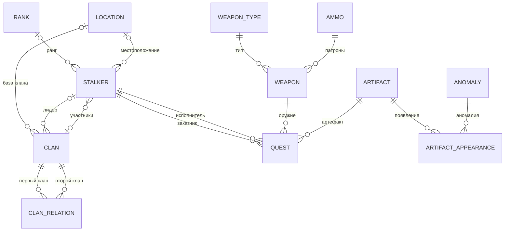

# База данных S.T.A.L.K.E.R.

Учебный проект по PostgreSQL. В базе хранятся данные о сталкерах, кланах, локациях и квестах. По ним можно узнать, какое оружие чаще встречается в квестах, где появляются артефакты и какие кланы дружат или враждуют.

## Файлы

- [01_schema.sql](01_schema.sql) создаёт 12 таблиц, ключи и ограничения.
- [02_data.sql](02_data.sql) заполняет таблицы демонстрационными данными.
- [03_queries.sql](03_queries.sql) содержит 50 запросов с исходной нумерацией заданий.
- [examples.sql](examples.sql) содержит три дополнительных запроса со сводными подсчётами и оконными функциями.

## Как запустить

В терминале из папки проекта создайте пустую базу, загрузите схему и данные, затем выполните запросы:

```sh
createdb --encoding=UTF8 stalker_demo
psql -X -v ON_ERROR_STOP=1 -1 -d stalker_demo -f 01_schema.sql -f 02_data.sql
psql -X -v ON_ERROR_STOP=1 -d stalker_demo -f 03_queries.sql
```

Если пользуетесь DBeaver, подключитесь к пустой базе и выполните целиком `01_schema.sql`, затем `02_data.sql`. Чтобы запустить конкретный запрос из `03_queries.sql`, поставьте в него курсор и нажмите **Cmd+Enter** на macOS или **Ctrl+Enter** на Windows и Linux.

## Как связаны таблицы



В запросах оружие и артефакты сталкера берутся из квестов, где он указан исполнителем. Запрос № 9 ищет артефакты, появившиеся ровно год назад. В демонстрационных данных две даты рассчитываются при загрузке, поэтому этот запрос удобно запускать сразу после неё.

Все 50 заданий и три дополнительных примера проверены на PostgreSQL 18.6 через PGlite. На демонстрационных данных каждое задание вернуло результат.
